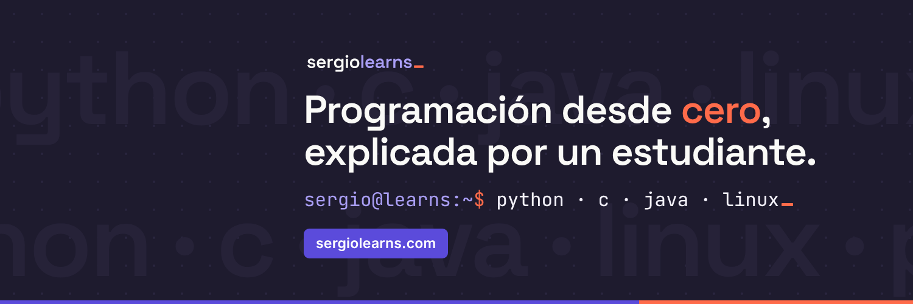

<a href="https://sergiolearns.com"></a>

## Hola, soy Sergio

Estudio **Ciencia e Ingeniería de Datos en la ULPGC** y escribo **[sergiolearns.com](https://sergiolearns.com)**, una web para aprender a programar desde cero explicada como me hubiera gustado que me la explicaran a mí: con teoría, programas resueltos y ejercicios con solución, en español y en inglés.

```bash
sergio@learns:~$ cat ahora.txt
Python · Java · C · Linux   → ya en la web
Datos y estadística (2º)    → lo siguiente
```

### Dónde está el código

- **[sergiolearns-codigo](https://github.com/sergiolearns/sergiolearns-codigo)**: todos los programas resueltos y las soluciones de los ejercicios de la web, ordenados por lenguaje y tema.

### Lo último en la web

<!-- BLOG-POST-LIST:START -->
- [Matrices y determinantes — teoría con mensajes cifrados, el rango, la inversa y el número que decide si se puede descifrar &lpar;y la clave que no servía&rpar;](https://sergiolearns.com/matrices-y-determinantes/)
- [Matrices y determinantes — práctica guiada con cinco problemas a mano, cada uno comprobado en MATLAB &lpar;y la inversa que no daba la identidad&rpar;](https://sergiolearns.com/matrices-y-determinantes-practica/)
- [Matrices y determinantes — ejercicios tipo examen con el cifrado, un parámetro, el determinante de la diagonalización y un test de 20 &lpar;y la fila que multipliqué por 2&rpar;](https://sergiolearns.com/matrices-y-determinantes-ejercicios/)
- [Instalar QtSpim — Windows, Linux y Mac, los ajustes del laboratorio y tu primer programa MIPS en 10 minutos &lpar;y el día que QtSpim no veía mi archivo&rpar;](https://sergiolearns.com/instalar-qtspim/)
- [Cómo usar QtSpim — registros, segmentos de texto y datos, paso a paso y puntos de ruptura con un programa real &lpar;y el bucle que no terminaba nunca&rpar;](https://sergiolearns.com/como-usar-qtspim/)
<!-- BLOG-POST-LIST:END -->

### Con lo que trabajo


### Dónde encontrarme

[](https://sergiolearns.com)
[](https://www.youtube.com/channel/UCwV9eDy7IQ2a6fPRJKrG-jg)
[](https://www.tiktok.com/@sergiolearns)
[](https://www.instagram.com/sergiolearns/)
[](https://www.linkedin.com/in/sergiomedinalearns/)
[](https://x.com/sergiolearns)

Cada semana subo un vídeo corto con un concepto, un error típico o un reto de código. ¿Una duda o un error en algún artículo? Escríbeme desde la [página de contacto](https://sergiolearns.com/contacto/).
