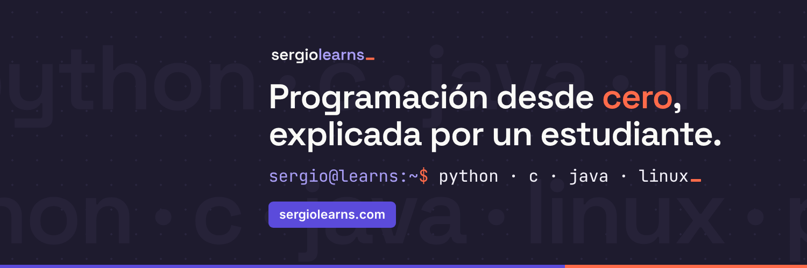

<a href="https://sergiolearns.com"></a>

## Hola, soy Sergio

Estudio **Ciencia e Ingeniería de Datos en la ULPGC** y escribo **[sergiolearns.com](https://sergiolearns.com)**, una web para aprender a programar desde cero explicada como me hubiera gustado que me la explicaran a mí: con teoría, programas resueltos y ejercicios con solución, en español y en inglés.

```bash
sergio@learns:~$ cat ahora.txt
Python · Java · C · Linux   → ya en la web
Datos y estadística (2º)    → lo siguiente
```

### Dónde está el código

- **[sergiolearns-codigo](https://github.com/sergiolearns/sergiolearns-codigo)**: todos los programas resueltos y las soluciones de los ejercicios de la web, ordenados por lenguaje y tema.

### Lo último en la web

<!-- BLOG-POST-LIST:START -->
- [Planificación de la CPU — teoría con FCFS, SJF, SRTF y Round Robin dibujados en diagramas de Gantt &lpar;y el parcial en que olvidé restar la llegada&rpar;](https://sergiolearns.com/planificacion-de-la-cpu/)
- [Planificación de la CPU — ejercicios tipo examen con test, cinco diagramas de Gantt que se corrigen solos y preguntas de desarrollo &lpar;y la llegada que ya no se me olvida restar&rpar;](https://sergiolearns.com/planificacion-de-la-cpu-ejercicios/)
- [Planificación de la CPU — práctica con problemas guiados paso a paso: FCFS frente a SJF, una expulsión en SRTF, la cola de Round Robin y un ejercicio con el formato del examen &lpar;y el cuanto que le regalé a quien no tocaba&rpar;](https://sergiolearns.com/planificacion-de-la-cpu-practica/)
- [Procesos e hilos — teoría con un gcc que nace, se bloquea y termina, un fork&lpar;&rpar; que se multiplica y spotify con tres hilos &lpar;y el bucle que llenó mi terminal de «Hola»&rpar;](https://sergiolearns.com/procesos-e-hilos/)
- [Procesos e hilos — ejercicios tipo examen con estados que trazar, fork&lpar;&rpar; que contar e hilos que lo comparten casi todo &lpar;y el «Hola» que salió ocho veces&rpar;](https://sergiolearns.com/procesos-e-hilos-ejercicios/)
<!-- BLOG-POST-LIST:END -->

### Con lo que trabajo


### Dónde encontrarme

[](https://sergiolearns.com)
[](https://www.youtube.com/channel/UCwV9eDy7IQ2a6fPRJKrG-jg)
[](https://www.tiktok.com/@sergiolearns)
[](https://www.instagram.com/sergiolearns/)
[](https://www.linkedin.com/in/sergiomedinalearns/)
[](https://x.com/sergiolearns)

Cada semana subo un vídeo corto con un concepto, un error típico o un reto de código. ¿Una duda o un error en algún artículo? Escríbeme desde la [página de contacto](https://sergiolearns.com/contacto/).
