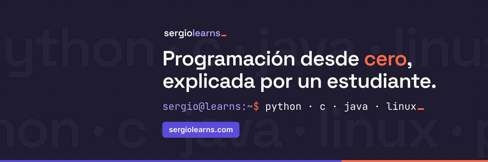

<a href="https://sergiolearns.com"></a>

## Hola, soy Sergio

Estudio **Ciencia e Ingeniería de Datos en la ULPGC** y escribo **[sergiolearns.com](https://sergiolearns.com)**, una web para aprender a programar desde cero explicada como me hubiera gustado que me la explicaran a mí: con teoría, programas resueltos y ejercicios con solución, en español y en inglés.

```bash
sergio@learns:~$ cat ahora.txt
Python · Java · C · Linux   → ya en la web
Datos y estadística (2º)    → lo siguiente
```

### Dónde está el código

- **[sergiolearns-codigo](https://github.com/sergiolearns/sergiolearns-codigo)**: todos los programas resueltos y las soluciones de los ejercicios de la web, ordenados por lenguaje y tema.

### Lo último en la web

<!-- BLOG-POST-LIST:START -->
- [Redirecciones y tuberías en Linux — teoría con el registro del aula, el misterioso orden de 2&gt;&amp;1 y filtros que se encadenan &lpar;y un sort que me dejó sin la lista del grupo&rpar;](https://sergiolearns.com/redirecciones-y-tuberias-en-linux/)
- [Redirecciones y tuberías en Linux — práctica con un informe que crece con &gt;&gt;, un ranking guardado con tee y avisos separados de lo correcto &lpar;y el informe que se comió a sí mismo&rpar;](https://sergiolearns.com/redirecciones-y-tuberias-en-linux-practica/)
- [Redirecciones y tuberías en Linux — ejercicios con intentos fallidos, rankings que se parten y un 2&gt;&amp;1 en el sitio equivocado &lpar;y un grep que contaba cero errores con la pantalla llena de ellos&rpar;](https://sergiolearns.com/redirecciones-y-tuberias-en-linux-ejercicios/)
- [Permisos en Linux — teoría con chmod en octal y en letras, umask y la carpeta de un trabajo en grupo &lpar;y el script que no quería arrancar&rpar;](https://sergiolearns.com/permisos-en-linux/)
- [Permisos en Linux — práctica con la carpeta de un trabajo en grupo, tres usuarios y un revisor de permisos &lpar;y la compañera que no podía compilar&rpar;](https://sergiolearns.com/permisos-en-linux-practica/)
<!-- BLOG-POST-LIST:END -->

### Con lo que trabajo


### Dónde encontrarme

[](https://sergiolearns.com)
[](https://www.youtube.com/channel/UCwV9eDy7IQ2a6fPRJKrG-jg)
[](https://www.tiktok.com/@sergiolearns)
[](https://www.instagram.com/sergiolearns/)
[](https://www.linkedin.com/in/sergiomedinalearns/)
[](https://x.com/sergiolearns)

Cada semana subo un vídeo corto con un concepto, un error típico o un reto de código. ¿Una duda o un error en algún artículo? Escríbeme desde la [página de contacto](https://sergiolearns.com/contacto/).
